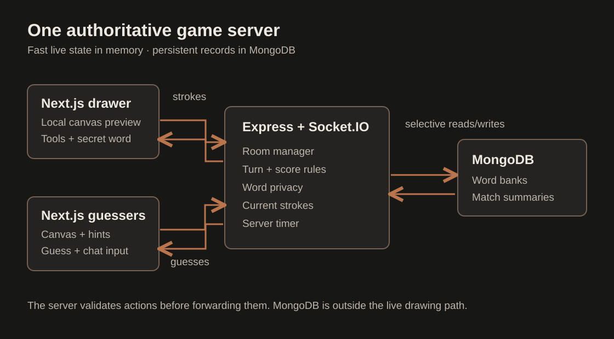
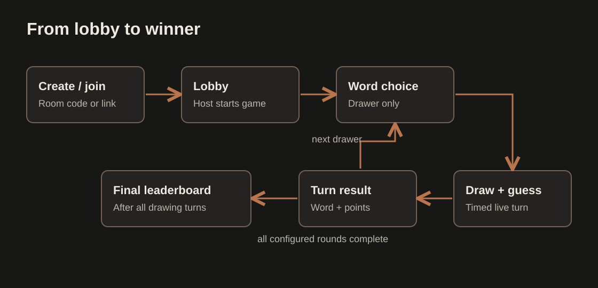

# Architecture Notes

## Overview

Atelier is split into two independent packages:

- `frontend/` — Next.js App Router UI, HTML5 Canvas board, and Socket.IO client.
- `backend/` — Express HTTP server, Socket.IO real-time room/turn engine, and MongoDB persistence.

## Key Design Decisions

| Area | Choice | Rationale |
| --- | --- | --- |
| Live room state | Server memory (`Map<string, Room>`) | Timers, strokes, and scores update every second; keeping live state in memory avoids database writes on pointer movement. |
| Database | MongoDB (optional fallback) | Stores the word bank and completed match summaries. If `MONGODB_URI` is unset or unavailable, the server falls back to its built-in categorized word list. |
| Canvas sync | Normalized coordinates (`0`–`1`) | Strokes scale cleanly across different screen sizes and DPRs. The drawer paints locally first and streams bounded points over Socket.IO. |
| Word privacy | Server-authoritative checks | Only the active drawer receives `word_options` and `your_word`. Guess matching runs exclusively on the server. |
| Rate limiting | HTTP + per-socket sliding windows | Protects `/health`, room creation/joining, guesses, and drawing events from flooding. |

## Game Flow

1. **Lobby:** Host configures players, rounds, draw time, word count, hints, word mode (`Normal`, `Hidden`, `Combo`), and category. Players can ready up; host starts with 2+ connected players.
2. **Word choice:** Server picks `N` words and sends `word_options` only to the current drawer (12s timeout auto-picks if idle).
3. **Drawing & guessing:** Server starts the countdown, computes progressive hints, validates/relays strokes from the drawer, and scores normalized guesses (speed bonus + 50pt drawer bonus).
4. **Rotation & finish:** Turns rotate across connected players for the configured number of rounds, then display the final leaderboard with a **Play Again** option for the host.

## Scaling Note

Live rooms live in single-process memory. Horizontal scaling across multiple backend instances would require a shared store (e.g., Redis) and a Socket.IO adapter.
